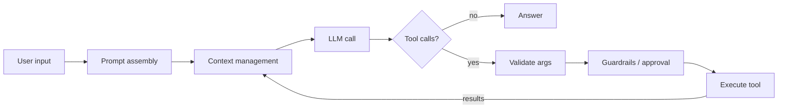

# Agent Harness, Explained

A working AI agent on the left, and a live look inside its **harness** on the right.

The agent is a **data analyst**: ask a question in plain English and it inspects tables, writes SQL, runs it in your browser (DuckDB-WASM), draws charts and remembers insights.

The right-hand panel has two views, with a KPI strip on top (tokens, cost, AI calls, tools used, time, working memory):

- **Simple** (default, for non-technical viewers): a live map. The *Agent* lights up as soon as you ask, its calls to the *AI model* animate, the *tool* it uses glows with its result, *Safety checks* show when your approval is needed, and *Working memory* / *Long-term memory* update as they change. Below the map, a plain-English “What just happened” story, with a *Why?* explainer on each step.
- **Technical**: the loop diagram, the raw event timeline (including the exact HTTP request sent to the model), the assembled prompt, the stored messages and concept cards.

**Live demo:** `https://<your-username>.github.io/agent-harness/`

- **No key?** It runs in demo mode: a scripted stand-in model drives the *real* harness and tools.
- **Bring your own key** for Anthropic (Claude), OpenAI or Google Gemini to ask anything. The key stays in your browser. There is no server.

---

## What is an agent harness?

An LLM on its own only turns text into text. The *harness* is everything around it that makes it an agent:



| Component | What it does here | Code |
|---|---|---|
| **Agent loop** | Call model → run requested tools → append results → repeat until it answers | [`src/harness/agent.js`](src/harness/agent.js) |
| **Prompt assembly** | Builds the system prompt from role, rules, live environment and memory; frozen per session | [`src/harness/prompt.js`](src/harness/prompt.js) |
| **Tools** | Name + description + JSON schema the model sees; `run()` the harness executes | [`src/harness/tools.js`](src/harness/tools.js), [`src/usecase/tools.js`](src/usecase/tools.js) |
| **Validation** | Model arguments are untrusted. Schema errors go back to the model so it can self-correct | [`src/harness/tools.js`](src/harness/tools.js) |
| **Guardrails** | allow / ask / deny policy per call, human approval for writes, caps on calls, tokens and cost per request, tool timeouts | [`src/harness/guardrails.js`](src/harness/guardrails.js) |
| **Context management** | Token budget, append-only history, output truncation, compaction into a summary | [`src/harness/context.js`](src/harness/context.js) |
| **Provider adapters** | One internal message format, translated to Anthropic / OpenAI / Gemini | [`src/providers/`](src/providers/) |
| **Reliability** | Exponential backoff on 429/5xx; errors become tool results, not crashes | [`src/providers/http.js`](src/providers/http.js) |
| **Memory** | Short-term = history; long-term = saved insights injected into the next session | [`src/harness/memory.js`](src/harness/memory.js) |
| **Observability** | Every step emits an event; both UI panels are just subscribers. Step mode + trace export | [`src/harness/events.js`](src/harness/events.js) |

### Things worth trying

1. **“Which product category drives the most revenue…”**: multi-step analysis, a chart, and two tools called in parallel.
2. **“Delete all orders with fewer than 2 units.”**: the policy classifies the DELETE as *ask*, and the loop pauses for your approval.
3. **“Who are our top 5 customers…”**: the model sends a malformed tool call, validation rejects it, and the model fixes it.
4. Turn on **Step mode** and click through each phase of the loop.
5. In Settings, lower the **context budget** to ~3000 to watch compaction happen.

---

## Design decisions

- **No backend, bring your own key.** The browser calls the provider directly (Anthropic needs the `anthropic-dangerous-direct-browser-access` header for this). Keys live in memory, or in `sessionStorage` if the visitor opts in. A Content-Security-Policy restricts network calls to the three provider APIs and the CDN.
- **Raw HTTP instead of SDKs.** The point is to *show* the requests, so each adapter builds the exact JSON body that appears in the inspector.
- **Append-only history.** Earlier turns are never edited. Large tool outputs are truncated *before* entering history. When the budget is exceeded, the whole session is summarized into one message (simple compaction). This keeps prompt caching effective and keeps preserved reasoning valid on current Claude models, whose thinking blocks are replayed verbatim.
- **Two output channels per tool.** Compact JSON for the model, rich tables and charts for the user.
- **No build step.** Plain ES modules, so the code in this repo is exactly the code that runs.

## Run locally

Any static file server works. ES modules don't load from `file://`, so open it through a server:

```bash
npx serve .
```

or

```bash
python -m http.server 8000
```

## Deploy (GitHub Pages)

1. Push this repo to GitHub.
2. **Settings → Pages → Build and deployment → Source: GitHub Actions.**
3. Every push to `main` deploys via [`.github/workflows/deploy.yml`](.github/workflows/deploy.yml).
4. Set `repoUrl` in [`src/config.js`](src/config.js) so the guide's “where in the code” links point at your repo.

## Project layout

```
index.html, styles.css
src/
  main.js              wiring: one event bus, one agent, two views
  config.js            repo URL for source links
  harness/             the reusable harness: no UI code
    agent.js events.js tools.js context.js guardrails.js memory.js prompt.js pricing.js
  providers/           anthropic.js openai.js gemini.js demo.js http.js
  usecase/             db.js (DuckDB) tools.js sample-data.js demo-scripts.js
  ui/                  chat.js, liveview.js (Simple view), kpis.js, inspector.js (Technical view),
                       diagram.js concepts.js settings.js util.js
```

## Adding a tool

```js
{
  name: 'my_tool',
  description: 'When and how the model should use this.',
  schema: { type: 'object', properties: { q: { type: 'string' } }, required: ['q'], additionalProperties: false },
  policy: (input) => ({ decision: 'allow', reason: '…' }),   // optional: allow | ask | deny
  async run(input) { return { content: {/* for the model */}, display: {/* for the UI */} }; },
}
```

Register it in `createAnalystTools` ([`src/usecase/tools.js`](src/usecase/tools.js)). It then appears in the prompt, the validator, the policy step and the inspector automatically.

## Costs & privacy

When you use your own key, calls are billed to your provider account. Each request is capped (default: 8 model calls, $0.50, 250k tokens; adjustable in Settings). Uploaded CSVs and saved insights never leave your browser, except for the query results the agent sends to the model you chose.

## License

MIT
